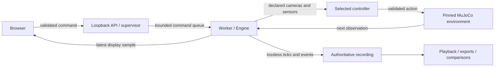

# Runtime and evidence architecture

Palimpsest keeps one mutable simulator/controller owner and derives presentation
from its records. Start with the [installation and commands](../README.md),
[operating runbook](reports/lab-hardening-runbook.md), and
[requirements-to-evidence matrix](requirements-evidence.md). The combined branch
is under review; the [progress brief](progress.md) identifies unfinished releases.

## A live control tick

[lab.py](../src/palimpsest/lab.py) validates API/session/origin and path inputs,
admits one owner, supervises progress and reaps it before the next run.
[worker.py](../src/palimpsest/worker.py) owns queue transport, recording admission,
initial snapshot registration and display publication. Display samples can be
replaced by newer samples; authoritative events cannot be silently dropped.

[Engine](../src/palimpsest/engine.py) applies idempotent commands at control
boundaries, checks expected state/episode/revision, projects allowed observations,
validates the selected controller's output, and advances physics. Tick rows
record inputs and pose before the step, then actual controls, next pose, reward
and simulation time after it. A browser receipt is distinct from application at
a simulation boundary. Wall-clock display/inference timing is distinct from
advanced simulation time.

The policy receives two RGB eyes and declared contact/relative-bearing sensors.
Evaluator geometry, overlays and path exports are not extra policy inputs.
The analytical teacher and privileged acquisition scripts declare their broader
access explicitly. Manual control, the legacy FLYNN profile and reduced male
CPU profiles have separate identities; failure never silently selects another.

## Durable state and recovery

| Module | Responsibility |
| --- | --- |
| [records.py](../src/palimpsest/records.py) | Manifests, ordered JSON events, checksummed numeric chunks, completion and bounded recovery of a published prefix. |
| [snapshots.py](../src/palimpsest/snapshots.py) | Complete native physics, mutable model/environment fields, observation, controller state, application state and RNG; identity validation before restore. |
| [replay.py](../src/palimpsest/replay.py) | Registered snapshot provenance, executable action/policy replay and first-divergence reporting. |
| [storage.py](../src/palimpsest/storage.py) | Per-user writer lease, fresh disk accounting, free-space floor and configured byte/count limits. |
| [artifacts.py](../src/palimpsest/artifacts.py) | Validated recording reader, playback, comparison provenance and bounded SVG/PNG/bundle export. |

Run directories and snapshots are authoritative local evidence; the SQLite index
is rebuildable. A recovered incomplete prefix is not silently relabelled as a
completed experiment. Snapshots carry software/model/numerical identity and a
durable event prefix. Preserving a controller restores its state; replacing one
preserves the world but explicitly starts fresh controller state.

Playback displays recorded values without running physics. Action replay runs
physics with recorded actions and skips inference. Policy replay recomputes
inference and compares it with the record. Successful execution alone does not
mean agreement. Exact CPU continuation is scoped to retained measurements;
strict CUDA continuation remains unqualified.

## Memory, task and model extensions

[memory.py](../src/palimpsest/memory.py) separates factual M, episodic E and revision
rules U. Fitting reads E; selecting with U changes uncertainty and inspection
requests, not factual payloads. [memory_task.py](../src/palimpsest/memory_task.py)
uses visibility-limited declared packets and evidence-based revisions. A U-only
branch validates all declared non-U invariant hashes. Missing observations are
explicitly unobserved, never treated as evidence of unchanged occupancy.

The three headless [controller references](plans/m5-controller-references.md)
restore one exact acquired physical state and freeze memory as unused audit
state. Original FLYNN retains its upstream true-goal-derived bearing; the sensor
script uses only the visible common-goal bearing/contact; the analytical teacher
uses privileged geometry. These information differences remain explicit. The
references have separate admission and conditional replay routes. Their six-owner
native development gate passes 744 intervals: 260 actual FLYNN policy intervals
and 484 sensor-script/teacher intervals, with all six navigation goals. Memory
remains frozen. [Six reference replays](reports/m5-controller-reference-replays-v2.md)
pass 742 comparisons, including 129 actual neural-policy intervals; saved-action
replays do not invoke policy inference. Full counterbalance and held-out
qualification remain pending.

[task_profiles.py](../src/palimpsest/task_profiles.py) supplies visible-landmark
exploration and encoder-odometry homing. [task_mechanics.py](../src/palimpsest/task_mechanics.py)
contains bounded selection, odometry, wheel fitting and compensation helpers.
Standalone diagnostic success does not make an unintegrated task profile ready.

[male_policy.py](../src/palimpsest/male_policy.py) resolves a fixed seven-file CPU
bundle and verifies model/training/graph/interface identities before loading.
Its hidden state and artificial encoder are distinct from the legacy FLYNN
retina/population state. The [training report](reports/m7-training-pilot.md)
describes the reduced graph and one-seed pilot; it is not a biological mapping
or a topology-benefit result.

The [recovery research adapter](plans/m7-recovery-learning.md) admits the fixed
baseline plus two complete first-cycle segments, preserving executed actions and
their censored endings. [Named recovery development admission](plans/m7-recovery-development.md)
checks the frozen six-model index before reusing the existing tensor loader and
24-owner evaluator. Bulk corpus hashes are checked before and after evaluation;
policy provenance retains the small current reader inventory. Production model
admission remains unchanged. The
separate [puck learning interface](plans/m6-puck-learning.md) uses eight sensors
plus its own previous mode; training requires every fixed demonstration to pass
coverage admission. The retained first batch fails that gate despite twenty
natural goals and remains excluded from the trainer. The separately corrected
[twenty-owner collection](reports/m6-puck-teacher-collection-v2.md) passes unchanged
admission. [Three fixed CPU fits](reports/m6-puck-training-v2.md) now have audited
NPZ weights and all thirty epochs retained; student execution, replay and
closed-loop development still need qualification.

Research scripts freeze source identities, protocols and output bounds before
execution. Their reports distinguish collection, cleanup, validation and task
outcomes. Preserve failed outputs and use a new version for a changed protocol.
Run actual model, renderer, browser and performance jobs serially. Fixture CI
does not replace asset-backed simulation, held-out task evaluation, physical
qualification or independent exhibition operation.

Offline [artwork mappings](artwork-mappings.md) and the [atlas](artwork-atlas.md)
reuse validated evidence, label authored transformations and retain provenance.
They do not change sensor inputs. The [rover proposal](rover-procurement-proposal.md)
has no released physical actuation path; procurement and measured physical gates
remain separate requirements.

## Offline artwork extensions

[Afterimage](artwork-afterimage.md) is a distinct non-physics recording schema:
explicit local RGB/rights/time input, bounded fixed CPU model execution, then an
offline response-plane SVG. It reuses the recorder/storage/supervisor and carries
exact alignment/provenance; its renderer never imports the model or simulator.
[Anatomical pairs](artwork-specimens.md) instead read two curated local SWCs,
validate topology/provenance and render native x/z at one shared physical scale.
Neither renderer adds observations or actions to the live agent. See the
[supervised runbook](exhibition-runbook.md) for remaining operation/retention gates.
