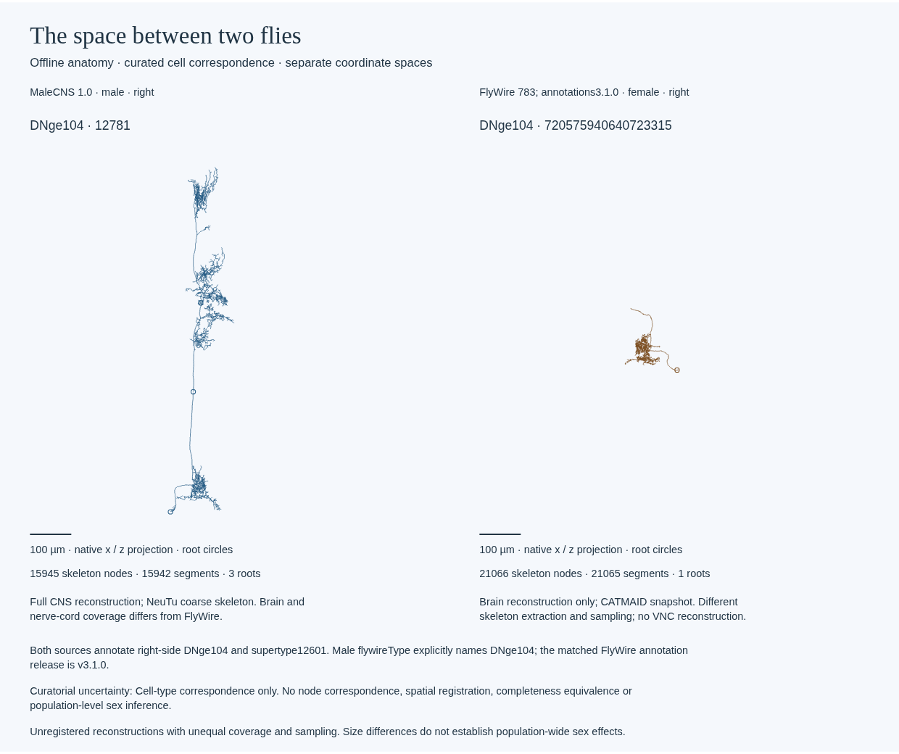

# Paired specimen artwork evidence

Frozen renderer `6fdab2f` produces a deterministic offline anatomical SVG from the
committed DNge104 bundle. Four focused fixtures pass (0.030 s, no skips). The
actual-source check independently compares every projected segment and root with
the parsed SWCs and verifies the female conversion against its retained CATMAID
node table. All source hashes remain unchanged; two fresh exports are identical.

| Source | Nodes | Parent-child segments | Disconnected roots |
| --- | ---: | ---: | ---: |
| MaleCNS 1.0 body 12781 | 15,945 | 15,942 | 3 |
| FlyWire 783 root 720575940640723315 | 21,066 | 21,065 | 1 |

The shared scale is 0.5515270104358502 pixels per micrometre. The 1,742,443-byte SVG
has SHA-256 `88b0dd69d23ced240199aede489dc29014ae5b7cb46d79f4617615c82ae61949`.
Its two batched paths preserve all 37,007 independent segments; no simplification
or synthetic joining occurs. Both native x/z coordinate spaces remain separate.

Chromium inspection of the byte-identical preparation SVG finds all segments,
four root markers and provenance metadata, with no clipped text, page errors or
external HTTP requests. The screenshot below was visually reviewed. The default
newer Playwright browser was absent; selecting system Chromium with that client
subsequently timed out in screenshot capture. The already verified Playwright
client with system Chromium and a viewport screenshot passes in 0.803 s. This
checks the artifact in that combination, not general browser compatibility or a
performance claim. Batching alone did not resolve the earlier capture timeout.

The [evidence index](m9-specimens.json) binds source/render/browser/preview hashes.
Primary local render evidence is retained at
`runs/m9-specimens-6fdab2f-20261002/`; browser evidence is at
`runs/m9-specimens-preparation-20261002/`. The original public CATMAID acquisition
is retained locally, while the committed conversion and provenance permit the
artwork to render offline from a fresh checkout.

This validates an authored anatomical view, not node-level homology, equal
coverage/completeness, population sex differences, biological function, physical
drawing, exhibition duration or independent operation. Source annotations support
only the declared curated cell-type correspondence. See the
[usage and limitations](../artwork-specimens.md) and
[distinct third-party terms](../../THIRD_PARTY_NOTICES.md).
