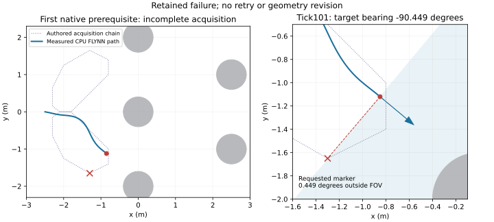

# Memory-v2 feasibility: implementation passes, acquisition fails

4 October 2026. Approved scope: [execution contract](../plans/memory-v2-feasibility.md).
Scientific code froze at `5f22585`; runtime integration is `253f7f6`.
This is development evidence. R2, R3, learned puck capability and physical/operator
qualification remain open.

## What was implemented

- One categorical supervisor shared by all selectors: acquire, commit, follow,
  inspect, retreat, replan and terminal phases. Its route decisions read M.
- Unknown initial M, real CPU FLYNN acquisition, visible arrival tokens and the
  unchanged 4 m/±90° visibility rule. Missing selected bearings fail explicitly.
- Packet version 2, memory state version 3 and application snapshot version 8, complete native/model/RNG continuation
  state, strict float32/16 MiB snapshot admission before owner allocation.
- Headless-only admission, nine-selector fixtures and continuation policy replay.
  Full acquisition recordings without a tick-zero snapshot cannot be policy
  replayed; action replay is not admitted for this private FLYNN profile.
- A bounded four-condition/six-case pilot runner, independent packet/M/commitment
  replay, failure scores, per-owner caps and detached-worker cleanup receipts.
- Retained-input control diagnostics, without new fitting or model promotion.

The exact 20-cylinder candidate passes analytic crossing, closed-gate, endpoint
bypass, clearance and waypoint-center visibility checks. Public route costs are
5.054335509 m and 5.243579908 m; the difference comes from the authored detour.
Those checks do not establish controller feasibility throughout an arrival disk.

## Actual attempt and stopping

| Stage | Actual disposition |
|---|---|
| Offline diagnostics | Completed in 59.70 s; 9 puck checkpoints and 12 navigation response artifacts. |
| Native prerequisites | First owner failed; 71.56 s stage, 68.58 s worker, 101 control ticks. |
| Remaining prerequisites | Seven unattempted. |
| Paired pilot | Unattempted; no own/swapped/no-U/sham native comparisons. |
| Readout |5.11 s scripted work; conservative 326 s post-execution window includes inspection and independent audit. |

The bounded executor took 131.78 s. Conservative total wall accounting through
readout completion is 458 s, below 7200 s. Outputs were 23,874,120 bytes before the small
completion receipt, below 8 GiB. The initial 10 GiB and continuing 2 GiB free-space
requirements held. No retry, replacement scene, new fit, reserved data or hardware
operation followed. Documentary publication copies add approximately 2 MiB.

Owner `f1bc7d409fcd4f34bc8c0e3eb6a1a83a` attempted `south-no-event`. FLYNN acquired a
south passage `open` sample at tick 69 and began its authored acquisition return.
At tick 101 the requested `retreat-1` landmark was 0.695042942 m away at −90.449080294°
relative to the measured heading. It was outside ±90° visibility and raised
`CueUnavailable`. South remained observed-open; north remained unknown. Acquisition
did not return to the decision boundary. No acquired snapshot, armed event, route
commitment or scored continuation was reached.

Independent inspection rehashed all 23 original indexed artifacts, bound 101 actual
policy calls to raw observations/actions, reconstructed 102 packets including the
sensor-only failed tick, and reproduced every memory decision and final M exactly.
Code/upstream hashes match their recorded identities. Preflight/worker asset hashes
were retained; the independent reviewer did not additionally rehash assets.
The owner exited and no matching PID/starttime/PGID remained. This audits a retained
failure; it does not pass native feasibility, restore, route, retreat or paired gates.

The first readout annotation accidentally named the following waypoint.
[Corrected annotation](memory-v2-evidence/retained-failure-audit-v2.json) binds the
requested ID to the recorded failure; [original annotation](memory-v2-evidence/retained-failure-audit-v1.json)
is retained as superseded. The native attempt and raw trace did not change.

## Offline diagnostic findings

All retained metric comparisons matched within 1e−6. Input hashes verified before
and after. Puck uses qualified NumPy checkpoint arithmetic; navigation reads saved
responses. No Torch model or native simulator was instantiated by diagnostics.

Puck train/recorded-dev remain 5,710/1,314 rows. Geometry and exact mode matching
do not fix nearest-neighbor errors:

| Training-only nearest neighbor | Dev normalized MSE | Turn-only velocity leak | Heading sign agreement |
|---|---:|---:|---:|
| All 9 features |.045000|22.64%|60.49%|
| Geometry before mode |.049616|22.64%|60.99%|
| Exact mode, geometry distance |.049616|22.64%|60.99%|

All fail the unchanged joint gate. The retained lowest-MSE puck checkpoint,
`longer32` seed 23, still scores .019526 MSE with 76.42% turn-only leak. Its heading
sign accuracy is 45.47% on 607 small headings in (1e−6,.01], 86.18% on 434 headings
in (.01,.12], and 98.85% on 174 headings above .12 rad. There are no targets in (0,1e−6].
Thus the aggregate sign metric is sensitive to small headings, while substantial
velocity/turn-mode error remains independently of that issue. This observation
does not amend the gate or qualify a model. Whole-layout-left-out neighbor distance
distributions and error/support associations are descriptive, without an OOD gate.

Navigation exactly replays advice contact, recovery state and all start/completion/
replacement transitions. On 2,103 advice-dev rows, 567 are recovery rows and 44 are
negative-target contact onsets. The declared contact FSM plus normal bearing rule
matches all recovery actions: zero recovery loss, 100% onset reverse recall and
zero false reverses outside recovery. Total loss remains .147651 because the
1,536 outside-recovery rows contribute .202155 heading loss. The plain bearing
rule scores .202884 on advice-dev and .007443 on 1,228 old teacher-dev rows.

All 12 learned response artifacts still fail their historical requirements.
Conditioned graph models and MLPs have zero onset reverse recall. GRU seed 10 has
100% recall but 38.35% false reverses; seed 11 has 38.64%/14.00%; seed 12 has 68.18%/25.13%.
This separates reversal from normal-heading failure. It does not show that the
counterfactual teacher would clear collisions: the trajectories were driven by
learners, the privileged normal planner is not reconstructed, and old teacher
phase labels remain unknown. No topology or physical recovery claim follows.

## Verification and remaining work

The complete integrated default suite passes **878 tests with 24 skips**, in 116.79 s:
[command and limits](memory-v2-evidence/validation.md), [raw log](memory-v2-evidence/regression.log).
The previous TestClient hang did not recur; no causal production fix is claimed.

The next memory study needs a separately reviewed acquisition/waypoint amendment
that accounts for actual heading and the entire arrival neighborhood. The measured
failure is at a visibility boundary before any memory comparison; changing U or
opening held-out data cannot answer it. This report does not authorize another
layout, expanded sensing, manual recovery or rerun.

Native open crossings, closed-route retreat, real two-passage acquisition,
deterministic restore and all 24 paired continuations remain unqualified. R2 needs
that feasibility work before a confirmatory design. Puck/navigation require
separate prospective interventions; their frozen failures remain unchanged.

Machine-local raw evidence is under:
`runs/memory-v2-feasibility-20261004T093143Z/` in the research-phase checkout.
[Execution receipt](memory-v2-evidence/execution.json),
[full diagnostic decomposition](memory-v2-evidence/control-diagnostics.json),
[preflight candidate and input identities](memory-v2-evidence/native-preflight.json),
[prerequisite failure/unattempted ledger](memory-v2-evidence/native-prerequisites.json),
[worker outcome](memory-v2-evidence/native-worker.json),
[readout/index](memory-v2-evidence/readout-completion.json)
retain hashes and absolute input owners. Camera payloads remain local; the Git
copies are compact documentation, not a self-contained raw replay bundle.
