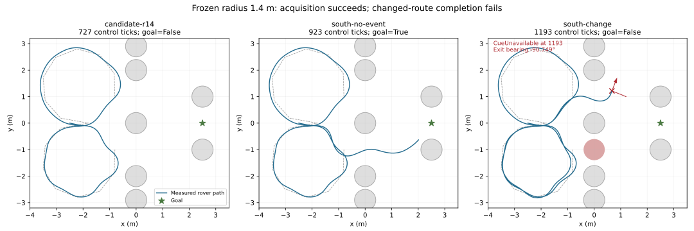

# Memory waypoint amendment: acquisition passes, changed-route completion fails

4 October 2026. Approved [prospective contract](../plans/memory-waypoint-amendment.md),
stacked on the original [memory-v2 feasibility attempt](memory-v2-feasibility.md).
Scientific implementation froze at `235bd35737c36185e7bf99799936557b49b7777e`.
The implementation and authorized bounded attempt are complete. Native prerequisites
failed, so R2, paired memory benefit, R3, learned puck capability and physical/operator
qualification remain open.

## What changed

Three geometry-only acquisition return profiles were registered in advance, with
loop radii 1.4, 1.3 and 1.2 m in that fixed order. Obstacles, start, passage inspection,
crossing, exit, detour, decision and goal points stayed fixed. The first independently
audited acquisition selects its profile for every subsequent prerequisite. There
are no retries, post-result coordinate edits or extra candidates.

Profile hashes now bind case regeneration, graph construction, manifests, private
Engine admission, selector provenance and snapshots. The original profile remains
the default: `30bce54fff21ff39910da74bd38f0e2ce4746e29c144e2979c39c0b28d356a5a`.
Its seed-400 original case hash remains
`0b2b81eb671f5474279ab1d80b9ad95110dc2698cd92b07f24ab06abb3efb99a`.
Original failed recordings were preserved and reaudited without a native rerun.

Packet 2, task state 3, application snapshot 8 and SNP container 1 stay unchanged.
Unknown initial M, one CPU FLYNN owner, 4 m/±90° sensing, circular occlusion, .75 m
passage samples, .35 m visible arrivals and explicit CueUnavailable remain unchanged.
This private headless scene remains absent from the lab catalog. Synthetic complete
candidate snapshots pass admission; cross-profile substitutions are refused before
allocation. Synthetic admission is not a successful native restore.

The opt-in runner freezes all three candidate coordinates, hashes and finite
arrival/heading surveys before launching an owner. It separates task failure from
infrastructure/source/raw-audit failure, accounts for preparation and cleanup inside
stage limits, and records every attempted/unattempted job. Native acquisition caps
and stalls must be reconstructed from actual motion and terminal events before
admitting a failed candidate as a reason to advance.

## Geometry evidence and its limits

All three candidates pass the original analytic centerline geometry checks. The
finite arrival survey uses .05 m positions, arrival-circle boundary samples and
5° headings, conditional on a legitimate visible arrival at the departing marker;
body-colliding poses are excluded. It retains unsafe combinations explicitly.

| Radius | Sampled transition/pose/heading combinations | Unsafe successor combinations | Native acquisition |
|---|---:|---:|---|
| 1.4 m | 138,222 | 61,800 | Selected; passed |
| 1.3 m | 139,380 | 61,358 | Unattempted after selection |
| 1.2 m | 140,394 | 60,746 | Unattempted after selection |

These are correlated, conditional finite samples, not independent trials,
probabilities, continuous guarantees or evidence that every arrival heading is safe.
The measured success below applies to one development acquisition, not arbitrary
headings or layouts. Full coordinates, hashes and unsafe examples are retained in
[candidates.json](memory-waypoint-evidence/candidates.json).

Selected profile:
`d4c7d0ca49b454d1d2ed94cb12d7939b6afa29a1cc3944f397557ad354a78909`.
Its selection receipt binds the original candidate ledger and development report:
[selected-profile.json](memory-waypoint-evidence/selected-profile.json).

## Actual attempt and stopping

| Job | Actual result | Control ticks | Scored continuation ticks |
|---|---|---:|---:|
| Development radius 1.4 m | Both real open observations acquired; returned to decision boundary | 727 | 0 |
| Development radius 1.3 m | Unattempted: first candidate selected | — | — |
| Development radius 1.2 m | Unattempted: first candidate selected | — | — |
| South/no-event | Mandatory open route passed; reached declared goal region | 923 | 196 |
| South/change | Acquisition, blocked inspection, retreat and one replan passed; route completion failed | 1,193 | 466 |
| North/no-event | Unattempted after mandatory failure | — | — |
| North/change | Unattempted after mandatory failure | — | — |
| South/prefix | Unattempted after mandatory failure | — | — |
| North/prefix | Unattempted after mandatory failure | — | — |
| Restore 1 | Unattempted after mandatory failure | — | — |
| Restore 2 | Unattempted after mandatory failure | — | — |
| Paired pilot | Unattempted by approved scope | — | — |

Development owner `43741cfe0745410fba409640bef5485c` obtained real south/north open
samples at ticks 69/408 and returned at tick 726, yielding 727 controls. This resolves
the original acquisition failure for this measured development trajectory.

South/no-event owner `5022a2806146479ab7ad0519feda3d1e` reached the declared .8 m
goal region: final distance .799084425 m. Its raw geometry, policy bindings and
memory/commitment replay passed.

South/change owner `355c4c8fabba4e2cb39a881cc844001c` acquired both initial open
observations. The gate applied at tick 728. The no-U supervisor committed to the
preferred south route at 729, observed it blocked, completed its retreat, replanned,
and committed to the open north route at 1054. Final M records south as blocked
and north as open. It reached the north detour and selected the north exit at 1184.

At the sensor-only tick 1193, the north exit `(1.2, 1.0)` was .572678466 m away at
**−90.749032576°**, outside the unchanged ±90° field of view by .749032576°.
Measured pose was `(0.669437289, 1.215554714, 1.197964719 rad)`. The exact exception
`selected_waypoint_unavailable: memory-v2-00000190-local_cue-change-0-subject-z-exit`
was independently reproduced from the retained packet and supervisor state. No
later neural policy call or supervisor progress followed that terminal packet.

The mandatory changed-route requirement includes goal completion. Successful
inspection, retreat and replanning do not pass it. Its worker status `recorded`
means the failure trace was retained and audited; it does not mean the scientific
gate passed. Likewise, CLI exit 0 means the bounded attempt finished correctly.
The prerequisite report is explicitly failed, with six later jobs unattempted.
No next candidate, rescue, new fit, paired pilot, held-out access or hardware work
followed this result.

## Audit, budgets and provenance

The native executor took **435.33 s**. Development including preflight was 122.83 s;
prerequisites including preparation were 311.61 s. Scripted readout took .88 s.
A further retained-evidence audit and plot finished inside the same readout window:
**123.75 s conservative readout, 558.20 s total**, below the 600/7200 s limits.
There was no transfer between development 1200 s, prerequisite 5400 s and readout
600 s allowances.

The original output receipt records 643,998,816 bytes; after the audit/plot the
inventory was approximately 644.32 MB, plus the small completion receipt. Publication
copies add approximately 1.47 MB, all below the aggregate 8 GiB limit. Initial
free space was 26,042,920,960 bytes, above the 10 GiB admission rule; continuing
2 GiB and bounded recording/SNP/log limits held. Source and prepared asset identities
were unchanged. All three exact PID/starttime/PGID owners had exited.

The post-execution auditor rehashed all **128 original indexed files**, consumed
**2,843 control rows/policy calls and 2,844 symbolic packets**, reconstructed packets
from raw measured poses and frozen geometry, and replayed exact M, selector,
commitment and supervisor state. Every audit matched its original scored report.
The terminal failure additionally required exact exception/tick/message replay.
[Readout completion](memory-waypoint-evidence/readout-completion.json) and
[reproduction script](memory-waypoint-evidence/retained-readout.py) retain the
accounting and checks. This is independent reconstruction of runtime claims using
the committed auditor, not an independent implementation of the audit algorithm.

Full prefix neural-state policy replay remains unsupported because the first
registered snapshot is after acquisition. Raw observation/action/camera hash
bindings and symbolic memory replay do not substitute for that missing tick-zero
policy replay. The two real deterministic restore owners were never attempted.

[Execution receipt](memory-waypoint-evidence/execution.json),
[development report](memory-waypoint-evidence/development/report.json),
[prerequisite report](memory-waypoint-evidence/prerequisites/report.json) and compact
per-owner manifests/jobs/worker/supervisor receipts are committed. Raw camera chunks
and acquired SNP payloads remain machine-local under
`runs/memory-waypoint-20261004T120942Z/` in the research-phase checkout. These compact
publication copies are not a self-contained raw or policy-replay bundle.

## Software verification and review

The final complete default suite passed **896 tests, 24 skips, 39 warnings in
122.47 s**, without exclusions or partitions. [Validation command and constraints](memory-waypoint-evidence/validation.md),
[complete raw log](memory-waypoint-evidence/regression-freeze.log). Opt-in skips
remain unqualified; actual native evidence above is separate from software tests.

A fresh independent review found three important defects: exclusive creation of
mutable progress receipts, trusting terminal CueUnavailable without exact final
packet replay, and stage preparation/cleanup missing from accounting. All were
reproduced with failing tests and fixed. The full software fixture also caught the
storage-lock root-creation conflict. A final source check added independently
reconstructed time-cap/stall admission. Focused final checks passed 44 tests;
the complete suite then ran against the scientific frozen head.

## What remains

The next scientific decision concerns the **north detour → exit transition under
measured arrival positions and headings**, which was outside this acquisition-only
geometry amendment. A separately reviewed prospective amendment is required for
another native attempt. Preserve this selected-profile failure as well as the
original profile's acquisition failure. Do not silently adjust exit coordinates,
sensing, arrival rules, controller, candidate order or gates and rerun.

Native route feasibility, north prerequisites and deterministic restores remain
incomplete. Even passing those would require a separate authorization/protocol
for paired memory comparisons; this amendment forbids the pilot. R2 needs evidence
of memory benefit, not acquisition alone. R3 and learned puck capability retain their
previous failures; held-out, physical hardware, operator and exhibition acceptance
remain open. No model promotion, release completion or automatic merge is claimed.

[Draft PR #67](https://github.com/Aadrika08/palimpsest/pull/67) publishes
`research/memory-waypoint-amendment`, stacked on
`research/memory-v2-feasibility` (draft #66). Repo-local author identity is
Aadrika Maurya <aadrikamaurya@gmail.com>; pushes/API publication use Aadrika08.
The original main remains `ee6bf61ea8faec02d5522c7eee30ab7cf333f29d`.
At published head `860213f`, fixtures/frontend jobs failed without starting:
GitHub reports failed recent payments or a spending limit that needs increasing.
[Exact live annotations](memory-waypoint-evidence/ci-annotations.json) retain that
external CI blocker separately from passing local tests. No workflow or account
billing settings were changed.
